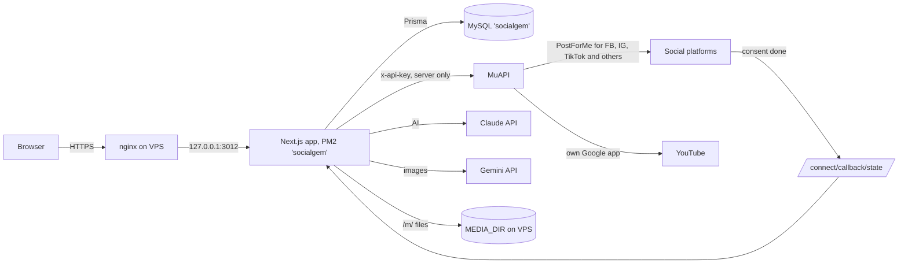
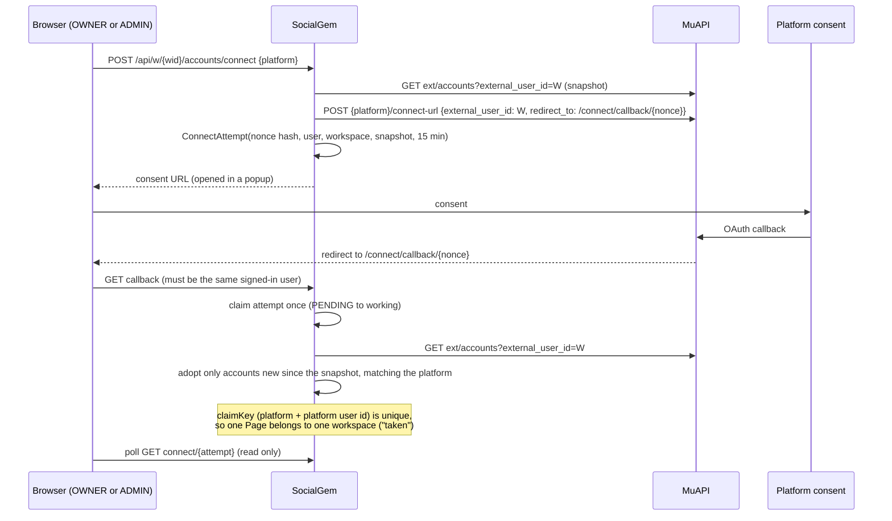
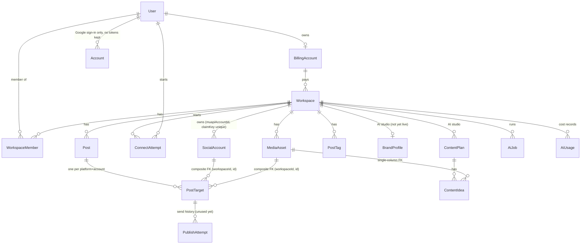

# SocialGem: multi-tenant integration audit

26 November 2026. Read-only review of the code on this computer, including the uncommitted YouTube, TikTok and AI studio work. No production code, database, migration or git history was changed. Live server settings were not inspected, except where noted.

**Verdict.** Tenant isolation holds in every place tested: 129 automated tests and 52 cross-workspace attacks against a production build all passed. There are no critical holes in what exists today. The main risks sit in work not built yet: the publisher, account lifecycle on archive, and any future platforms that hold their own tokens. They are listed below so they are designed in, not patched later.

---

## 1. Current architecture



- **One MuAPI key for the whole product.** It never reaches the browser; `src/server/muapi.ts` is the only module that calls MuAPI, which a test enforces.
- **Tenancy unit is the workspace.** People reach a workspace through `WorkspaceMember`, checked from the database on every request by `guardWorkspace` in `src/server/guard.ts`.
- **All customer data access goes through `dataFor(workspaceId)`** in `src/server/data.ts`, where every query carries the workspace.
- **No social tokens are stored by SocialGem.** MuAPI, and PostForMe behind it, hold them. SocialGem keeps only MuAPI's numeric account id.
- **Publishing does not exist yet.** Posts can be scheduled, but nothing sends them; `mode: "now"` and `publish_now` return 503.

### Connection flow (Facebook, Instagram, YouTube, TikTok)



### `external_user_id`

| Question | Answer |
|---|---|
| How is it made? | `Workspace.externalUserId`, a separate random cuid created with the workspace (`@default(cuid())`) |
| Where is it stored? | Only on `Workspace`, with a unique index |
| Is it the workspace id or a user id? | No. The probe confirmed it differs from both, so it reveals neither. |
| How is it mapped? | Always read from the workspace the guard loaded for the signed-in member, never from the request |
| Is it secret? | Not needed: only the server sends it, with our MuAPI key |
| Changes over time? | Never. Moving to a new one would orphan the workspace's MuAPI accounts. |

---

## 2. Database relationships (tenant-relevant)



**Strong points.**
- `Post`, `PostTarget` and `MediaAsset` use **composite foreign keys** `(workspaceId, id)`. The database itself refuses a post that points at another workspace's account or media; `tests/database.test.ts` covers this.
- `PostTarget` status changes are conditional writes, so a post that has started sending cannot be reopened.

**Weak points.** Only finding M7 below: `ContentIdea` is protected by code, not by the database.

---

## 3. Platform status

| Platform | Through | Per-customer connect | Status | Content rule enforced |
|---|---|---|---|---|
| Facebook Pages | MuAPI (PostForMe) | Yes, `connect-url` + `external_user_id` | Enabled | Text or media |
| Instagram (Business/Creator) | MuAPI (PostForMe) | Yes | Enabled | Needs photo or video |
| YouTube | MuAPI (own Google app) | Yes | Enabled, uncommitted | Video + title, at most 100 characters |
| TikTok | MuAPI (PostForMe) | Yes | Enabled, uncommitted | Video, title at most 150 characters |
| X | MuAPI (PostForMe) | **No**: only `GET /social/x/connect`, tied to our own MuAPI account | Off, refused in code | n/a |
| LinkedIn | MuAPI (PostForMe) | **No** | Off | n/a |
| Threads | MuAPI (PostForMe) | **No** | Off | n/a |
| Pinterest | MuAPI (PostForMe) | **No** | Off | n/a |

MuAPI's OpenAPI document was checked on 26 November 2026. `ext/accounts` list, rename, disconnect and delete are described as covering YouTube, TikTok, Instagram and Facebook only. The four "No" platforms are refused even if `PLATFORMS_ENABLED` lists them; a test and the probe both confirm this. MuAPI support has been asked to add per-customer connect for them.

---

## 4. Security findings

Severity is for SocialGem as deployed or about to be deployed. "Open" means not fixed; nothing was changed during this audit.

### High

**H1. MuAPI does not check which customer an account belongs to when publishing.** Publish endpoints take only `account_id` (MuAPI notes, section 4). Anyone holding our MuAPI key can post to any connected account of any customer, and a SocialGem bug that picks the wrong `account_id` would post to another customer's page. SocialGem's own database is therefore the only barrier. *Today:* the composite foreign key on `PostTarget` prevents the wrong account being attached; 52 probes found none. *Required for M4:* the publisher must load the account through `(workspaceId, socialAccountId)` at send time, re-check `status = ACTIVE` and that the workspace isn't archived, and only then use `muapiAccountId`. Keep the key out of logs, readable only by the app user (`chmod 600 .env`), and rotate it if exposed. Open.

**H2. The live site's `NEXTAUTH_URL` reported `http://localhost:3000` on 25 November.** While that lasts:
- login cookies lack the HTTPS-only flag, and the admin cookie loses its `__Host-` protection;
- `redirect_to` for account connection points at localhost, so live connections cannot finish;
- Google sign-in cannot work.

*Fix:* set `NEXTAUTH_URL="https://socialgem.online"` on the VPS and restart. Check with `curl -s https://socialgem.online/api/auth/providers`. Not re-checked today.

### Medium

**M1. What MuAPI does when two workspaces connect the same Page is undocumented.** SocialGem gives a Page to one workspace only, through the unique `claimKey`, and answers "taken". MuAPI's docs say reconnecting "reactivates the old row" by platform user id, but not whether it moves that row to the new `external_user_id`. If it does, workspace A's account row would keep a MuAPI id now listed under B. *Fix:* test this with two test workspaces and one test Page before launch (spike S1 in PLAN.md). Open.

**M2. Archiving a workspace leaves its accounts connected and its posts scheduled.** Access stops at once, as the probe confirmed, but MuAPI connections stay live and `SCHEDULED` targets remain claimable. *Fix:* on archive, cancel unsent targets and soft-disconnect accounts at MuAPI. The publisher must also skip archived workspaces. Open.

**M3. A disconnected account still reserves its Page.** `muapiAccountId` and `claimKey` stay set on `DISCONNECTED` rows, so another workspace gets "taken" forever. This is about availability, not security. *Fix:* clear `claimKey` on disconnect, or allow adoption when the existing row is `DISCONNECTED`. Open.

**M4. Future publish webhooks from MuAPI are unsigned** (MuAPI notes, section 1). *Fix, already in the plan:* per-attempt `hookTokenHash` in the callback URL, then confirm by polling, never trusting the webhook body. Not built yet.

**M5. Rate limits depend on nginx.** `clientIp` takes the last `X-Forwarded-For` entry. That is right behind nginx with `proxy_set_header X-Forwarded-For $proxy_add_x_forwarded_for;`. Without that header, every visitor shares one bucket, so one person could lock everyone out of login. The app listens only on `127.0.0.1`, so the header cannot be spoofed around nginx. *Fix:* confirm that line in `/etc/nginx/sites-enabled/socialgem`. Not checked.

**M6. There is no audit trail for customer actions.** Connect, disconnect, rename, schedule and delete are not recorded per workspace; only admin actions are. This matters for support disputes and incident review. *Fix:* write to `AuditLog`, which already exists, with `entityType` and the workspace. Open.

**M7. AI studio: `ContentIdea.mediaId` has a single-column foreign key** and `ContentIdea` has no `workspaceId`. Isolation relies on code (queries go through `plan.workspaceId`); the probe confirmed it holds. Unlike posts, though, the database would not stop a bug linking another workspace's image. *Fix:* add `workspaceId` and a composite FK before the `20261126000000_ai_studio` migration reaches the server. It is cheap now, because the migration has not been applied. **Fixed locally on 26 November, not yet deployed:** migration `20261126120000_content_idea_tenancy` adds `workspaceId` with foreign keys to `Workspace`, `(workspaceId, planId)` and `(workspaceId, mediaId)`. Every idea query names the workspace, and `tests/studio-tenancy.test.ts` covers it.

### Low

**L1. Generated images are public** at `/m/<32 random hex>.jpg`, by necessity, because platforms fetch them. Names can't be guessed. Deleting media in the app does not delete the file. *Fix:* remove files 30 days after deletion or publishing, as PLAN.md intends.

**L2. `remoteAccounts` accepts MuAPI rows that omit `external_user_id`.** It relies on MuAPI having filtered by the query. Rows that carry a different id are dropped. *Fix:* once MuAPI confirms the field is always present, require it.

**L3. Token columns on `Account`.** NextAuth's `Account` table still has `access_token`, `refresh_token` and `id_token` columns. The adapter now strips them, and tests confirm nothing is stored. Rows from before that change may still hold tokens. *Check on the server:* `SELECT COUNT(*) FROM Account WHERE access_token IS NOT NULL OR refresh_token IS NOT NULL OR id_token IS NOT NULL;`. Clear them if non-zero.

**L4. Expired or revoked connections are found lazily.** Account status is refreshed from MuAPI at most every 5 minutes, and only when someone opens Channels. There is no alert, and a revoked token surfaces only at publish time. *Fix:* daily check, plus `NEEDS_RECONNECT` notification by email and in the app, and a re-check just before sending.

**L5. One shared admin login.** Admin is a single password-only login (`ADMIN_USER`/`ADMIN_PASS`, by your choice), so actions are recorded only as "Super admin". It is rate limited and has short sessions. *Consider:* a second factor such as an authenticator app before the customer count grows.

**L6. The legacy `Session` table is unused.** Sessions are JWTs revoked through `sessionVersion`. Harmless; it can be dropped in a later migration.

### Not found (checked)

- **Server actions:** there are no `"use server"` actions; all writes go through guarded API routes, which a test enforces.
- **Background jobs:** there are no cron jobs and no publisher. AI jobs run in-process and are scoped to the workspace loaded at start.
- **Webhooks:** none are active. Stripe is switched off.
- **OAuth for Google sign-in:** every sign-in is decided before linking. Ended sessions cannot link, and linking needs a password plus a signed short-lived permission (`tests/google.test.ts`).
- **Connect callback:** single use, tied to the starting user and workspace, 15-minute expiry, and the state is in the path. The probe confirmed another user cannot complete it.

---

## 5. Tenant isolation tests

**Automated suite:** 129 of 129 pass, against local MySQL 8 with the test database only. Tenant-related tests:
- `database.test.ts`: composite FKs refuse cross-workspace references; another workspace's rows behave as non-existent; archived workspaces vanish; connect adoption is limited to the starter, single use, "taken" across workspaces, and two parallel returns adopt once.
- `guards.test.ts`: every API route is guarded; workspace routes use `guardWorkspace`; one MuAPI caller; unsupported platforms are never offered.
- `studio.test.ts`: plans, ideas and scheduling are invisible to other workspaces.
- `google.test.ts` and `admin.test.ts`: session and permission rules.

**Live probe:** two workspaces, Alice and Bob, ran against a local **production build**, the test database and a stand-in MuAPI that records every call. **52 of 52 passed.**

| Attack by Bob | Result |
|---|---|
| Read, create, edit or delete using Alice's workspace id: posts, accounts, media, tags, analytics, AI studio, plans, connect status, workspace settings (18 routes) | 404, no Alice data in any reply |
| Alice's object ids through Bob's own workspace routes (12 cases) | 404, or 409 with nothing changed |
| Schedule a post through Alice's account id | 400 "Choose a connected account"; no row created |
| Save a draft pointing at Alice's account | Draft saved without the account; no cross-link |
| Reuse Alice's media by URL | A separate media row in Bob's workspace |
| Forge the `sg_ws` cookie with Alice's workspace id | Bob's own data shown |
| Start a connection | MuAPI received Bob's `external_user_id` only |
| Connect X, LinkedIn, Threads or Pinterest with all platforms listed in `PLATFORMS_ENABLED` | 400 for each |
| Complete Alice's pending connection with her callback link | Refused; attempt stays pending |
| An EDITOR connects or disconnects accounts | 403 |
| A member removed mid-session | 404 on the next request |
| Cross-site write with a valid cookie | 403 |
| No session | 401 |
| Archived workspace | 404 |
| Afterwards | Alice's account and scheduled post unchanged; no MuAPI rename or disconnect of her account |

**Not covered:** real MuAPI behaviour (M1), the live server's settings (H2, M5, L3), and the publisher, which doesn't exist yet. The probe script is not in the repository; I can add it as a permanent test.

---

## 6. Recommended production architecture

```mermaid
flowchart TB
  subgraph Web["Next.js app (PM2: socialgem)"]
    R[Guarded API routes] --> D[dataFor(workspaceId)]
    R --> CF[Connect service]
  end
  subgraph Worker["Publisher (PM2: socialgem-worker)"]
    Q[Claim due targets with lease] --> V[Re-check tenant + account + workspace]
    V --> AD{Provider adapter}
  end
  D --> DB[(MySQL)]
  Q --> DB
  CF --> AD
  AD -->|MuAPI adapter| M[MuAPI: FB, IG, YT, TikTok]
  AD -->|Native adapters| X[X / LinkedIn / Threads / Pinterest APIs]
  AD --> V2[(SocialCredential: encrypted tokens)]
  W[Webhook /hooks/publish/{token}] -->|hint only| Q
```

1. **One provider-adapter interface** for MuAPI and native integrations: `startConnect`, `finishConnect`, `listAccounts`, `refresh`, `publish`, `status`, `revoke`. The rest of the app never knows which one is used.
2. **Publisher as its own PM2 process.** It uses the claim and lease design that is already in the schema and tested ("two workers never take the same post"). Before each send it re-reads the target, account and workspace in one query, scoped by `workspaceId`, and refuses if anything is not active.
3. **Idempotency.** A `PublishAttempt` row is created before sending. An unclear result becomes `NEEDS_CHECK`, never an automatic resend, because MuAPI has no idempotency key.
4. **Token storage for native platforms.** A new `SocialCredential` table, one per `SocialAccount`, holds access and refresh tokens. They are encrypted with AES-256-GCM under a 32-byte key from `TOKEN_ENC_KEY` outside the code, with a `keyVersion` column for rotation and a random nonce per value. Tokens are decrypted only inside the adapter at send time and never returned to the browser or logs. A later move to a cloud key service changes only the key provider.
5. **OAuth for native platforms.** Reuse `ConnectAttempt`, adding a PKCE verifier stored encrypted and a short expiry. Callbacks go to `/connect/oauth/{provider}`, with the same single-use, same-user and same-workspace checks as today. Ask only the scopes needed to publish.
6. **Lifecycle jobs.** A daily token refresh and health check for each account, with `NEEDS_RECONNECT` and notification. Archiving cancels and disconnects (M2). Deleting an account revokes at the platform.
7. **Audit.** Every connect, disconnect, schedule and publish is written to `AuditLog` with the workspace and user (M6).

### Native integrations, if MuAPI says no

These are my current understanding. **I did not re-check platform documentation, pricing or review rules today; confirm each before committing to a build.**

| Platform | API and sign-in | Publishing scope | Gatekeeping to expect |
|---|---|---|---|
| X | X API v2, OAuth 2.0 with PKCE | `tweet.write`, `users.read`, `offline.access`, plus media upload | Posting needs a paid API tier; check current price and posting caps |
| LinkedIn | OAuth 2.0 / OpenID Connect | Profiles: `w_member_social`. Company pages: Community Management API (`w_organization_social`) | Page posting needs LinkedIn's approval for a registered business; tokens are long-lived but refresh is limited |
| Threads | Meta Threads API, through a Meta app | `threads_basic`, `threads_content_publish` | Meta app review and business verification; post in two steps (create container, then publish) |
| Pinterest | Pinterest API v5, OAuth 2.0 | `pins:write`, `boards:read` | Starts with trial access; standard access needs review; each pin needs a board and an image or video |

A sensible order is LinkedIn profiles first (lightest review), then Pinterest, Threads and X, adjusted by what MuAPI answers and by demand.

---

## 7. Prioritised roadmap

| # | Item | Why | Effort |
|---|---|---|---|
| **P0, before anything else goes live** |||
| 1 | Set `NEXTAUTH_URL` on the VPS and confirm (H2) | Cookies, Google sign-in and live connections | Minutes, by you |
| 2 | Confirm the nginx `X-Forwarded-For` line (M5) and check for leftover tokens (L3) | Login lockout risk; stray tokens | Minutes, by you |
| 3 | Add `workspaceId` and a composite FK to `ContentIdea` before the AI studio migration (M7) | Free now, a migration later | 1 hour |
| 4 | MuAPI spike with test accounts: same Page in two workspaces, disconnect and reconnect, X reply settings (M1) | Unknown behaviour at the core of isolation | 0.5 day plus your test accounts |
| **P1, publishing (M4)** |||
| 5 | Provider-adapter interface, with MuAPI as the first adapter | Foundation for every platform | 1 day |
| 6 | Publisher worker: claim, re-check tenant, send, poll, `NEEDS_CHECK`, quota, with the H1 checks | The product's main job | 4–5 days |
| 7 | Webhook endpoint with per-attempt token, polling confirmation (M4) | Faster results without trusting MuAPI | 0.5 day |
| 8 | Make the probe permanent and extend it to the publisher | Prevents regressions | 0.5 day |
| **P2, lifecycle** |||
| 9 | Archive cancels and disconnects (M2); disconnect releases the Page (M3) | Stray sends; stuck Pages | 1 day |
| 10 | Daily account health, reconnect alerts, check before sending (L4) | Silent failures | 1 day |
| 11 | Customer audit log (M6) | Support and incidents | 0.5 day |
| **P3, more platforms** |||
| 12 | If MuAPI adds per-customer connect: enable each platform, then run the spike and probe | Cheapest route | Hours per platform |
| 13 | Otherwise: `SocialCredential`, encryption, OAuth with PKCE, then one native adapter at a time | Only route without MuAPI | 2–4 days per platform, plus platform reviews |
| 14 | File cleanup for media (L1); second factor for admin (L5) | Hygiene | 0.5 day each |
