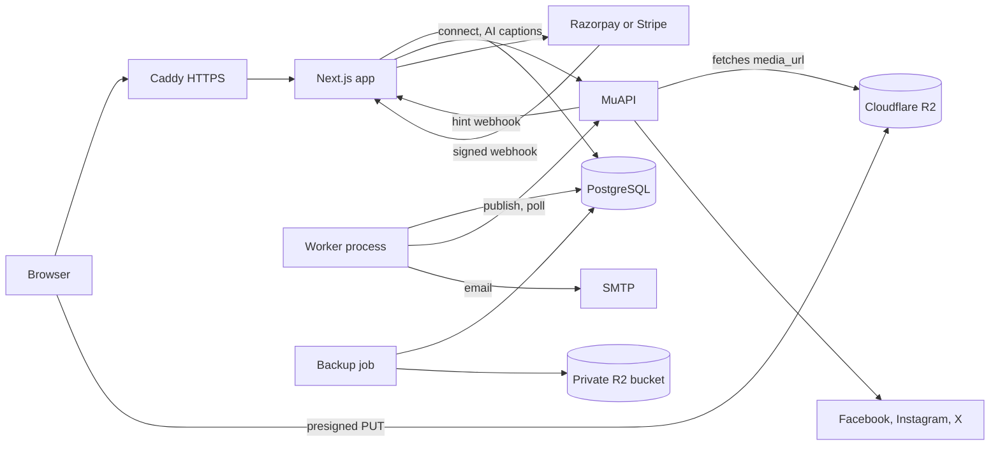
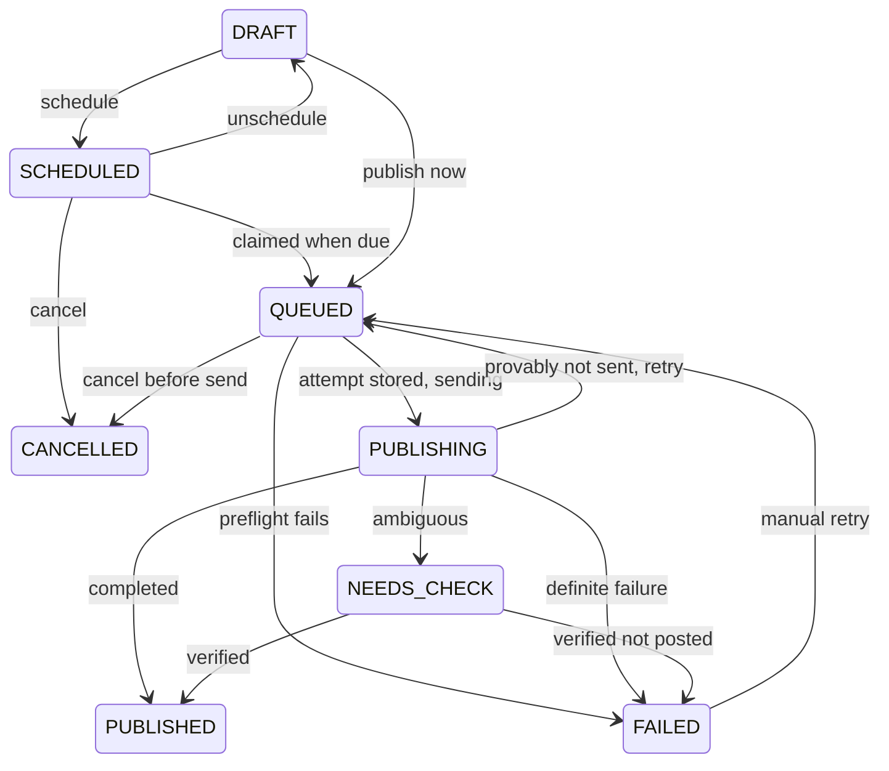

# SocialGem: development plan

Status: **awaiting approval**. No application code has been changed. MuAPI evidence: [MUAPI_NOTES.md](MUAPI_NOTES.md).

## 1. Summary

SocialGem becomes a multi-tenant scheduler: one Next.js app, one worker, PostgreSQL, R2 and MuAPI. The calendar and composer UI are largely reusable. The server layer, data model, publishing, billing and uploads need rewriting.

### Blocker
**X cannot be connected per customer by any documented endpoint.** Options:

| Option | Assessment |
|---|---|
| A. MuAPI adds or confirms an X `connect-url` with `external_user_id` | Best. Ask now |
| B. Use `GET /social/x/connect` with a one-time nonce as `account_name`, then find that nonce in our account list | Undocumented behaviour; the label may not be returned, and deduplication may hand back a row another workspace uses. Only if S1 proves it, and any ambiguity must refuse the connection |
| C. Launch with Facebook and Instagram; X flagged off | Safe fallback. **My recommendation if A is not available by the end of S1** |
| D. Integrate the upstream provider (apparently PostForMe) or another for X | Outside this brief; needs your decision and separate research |

All MuAPI access sits behind a `SocialProvider` interface so that D stays possible.

### Where I disagree with the brief or see risk
1. **Do not retry every 5xx.** The brief allows retry on 5xx without `request_id`. With no idempotency key, a 500/502/504 may arrive after acceptance. I propose automatic retry only when the request provably never left us (DNS failure, connection refused) or on 429; everything ambiguous becomes `needs_check`. The stricter rule protects "never publish twice".
2. **Add `needs_check`** to the status list; section 4.5 requires it.
3. **A post must be split.** One composition goes to several platforms, each with its own state, cost and retry: `Post` plus `PostTarget`. The brief's statuses apply to targets.
4. **`X-MuAPI-Cost-USD` may be absent on a given call.** Store submit and result cost, falling back to the body `cost` object; leave null rather than guess.
5. **Published URL is not guaranteed.** Instagram returns `media_id`, Facebook and X `publish_id`. Show a link only when one is returned or S1 proves the ID format.
6. **"No app reviews" depends on others.** Our product rests on MuAPI and probably PostForMe, under a terms clause against "competing services". Get written permission before spending on launch.
7. **Build the engine before the composer.** It is the greatest risk and does not depend on the composer.
8. **Text-only posts:** the schemas support them on Facebook and X, so the brief's "Facebook needs an image or video" message is not needed. Only Instagram requires media.

### Environment facts
- The folder is not a git repository and `node_modules` is absent. I read the Next docs from the pinned `next@16.2.7` npm package, unpacked outside the project.
- Docker is not installed on this machine, so images can only be verified in CI or on the VPS unless you install it.
- The brief names `SamurAIGPT/postiz-cheap`; the README links `Anil-matcha/postiz-cheap`. Confirm upstream.

### Next.js 16 rules that apply
Based on the upgrade, route-handler, proxy, instrumentation, self-hosting and authentication guides:
- `middleware` is now `proxy`, always Node runtime; not an authorisation layer. Checks belong in a data access layer and in every handler.
- `params`, `searchParams`, `cookies()`, `headers()` are async only.
- GET route handlers are uncached by default. We will not enable Cache Components.
- `next lint` is gone and `next build` does not lint, so CI runs ESLint itself. Turbopack is the default builder.
- Proxy buffers bodies to 10 MB by default, another reason for direct-to-R2 uploads.
- `src/instrumentation.js` `register()` runs once at server start: env validation goes there, so builds need no secrets.
- `NEXT_PUBLIC_*` values are fixed at build time. `APP_URL` is read server-side at runtime.
- SIGTERM drain needs a 10–30 second stop grace period.

## 2. Codebase review

Read in full: manifests, schema, `src/lib`, and all API routes. Client code: read the main data logic of the home page, composer, calendar (first part), integrations, login, pricing and shell. The remaining JSX, device previews, chart, agent UI, media grid and cropper were searched or sampled, not read line by line; each will be read before it is edited.

### Keep, change, remove

| Area | Decision |
|---|---|
| `ContentCalendar`, `LiveDevicePreview`, `MediaGrid`, cropper, `CustomSelect`, theme | Keep, adapt, split large files |
| `PostComposerModal` (1,963 lines) | Keep the layout; rewrite state, submission and upload |
| `AppShell`, `integrations`, `login`, `pricing` | Keep the look; rewrite behaviour |
| Analytics page | Reduce to our own counts |
| AI caption generation | Keep; meter, rate limit, validate output |
| Agent chat page | Not in the brief: question 11 |
| API routes, auth config, billing, social manager | Rewrite |
| `DemoStore`, `MediaStore`, in-memory tags, `SocialAccountStore` | Remove |
| `/api/download`, `/api/checkout`, `/api/webhook/stripe`, `/api/social/youtube/connect`, `/gallery`, `Navbar` if unused | Remove |
| `AppInstance`, `Creation`, `customApiKey` | Remove (unused leftovers) |
| `framer-motion`, `clsx`, `tailwind-merge`, `@stripe/stripe-js`, `axios` | Remove (first four never imported; axios used once) |

### The seven mandatory fixes

| # | Confirmed | Planned in |
|---|---|---|
| 1 | Yes: `GET /api/posts` publishes and polls | M1 stops it; M4 replaces it |
| 2 | Yes: also in the composer default, `PATCH`, and the GET path | M1 |
| 3 | Yes: also `MediaStore`, in-memory tags, and the demo auth fallback | M1 |
| 4 | Yes, worse: see B2 | M1 stops charging; M4/M6 ledger |
| 5 | Yes: rename is affected too | M1 guard; M2 |
| 6 | Yes | M1 schema; M2 |
| 7 | Yes: also "Creator Studio", the `P`/`A` logos, login and pricing copy, AI prompts, `muapi.ai` in previews | M0 |

### Additional bugs

| ID | Severity | Finding |
|---|---|---|
| B1 | Critical | **"Save draft" publishes immediately.** `PostComposerModal.jsx:1664` sends `scheduledAt: null`; the API treats that as publish now. No draft status is ever written |
| B2 | Critical | Immediate publish swallows credit-deduction errors (free posting); a failed submit is not refunded; due posts are not refunded when submission fails |
| B3 | Critical | No claim or lock: two tabs or concurrent GETs publish the same due post twice |
| B4 | Critical | Rescheduling resets any post to `scheduled`, including completed ones, so dragging a published card publishes it again. No state check on PATCH |
| B5 | Critical | `publishResult` and `publishedAt` are written but not in the schema. The update throws, so successes stay `processing` forever; analytics reads the missing field |
| B6 | High | `posts/[id]` never imports `config`; "publish now" hits a ReferenceError, or falls into the in-memory path and reports success |
| B7 | High | Without an API key, immediate posts are stored as `completed` with a made-up request ID; the demo path invents a published URL |
| B8 | High | Unknown platforms fall back to the YouTube endpoint |
| B9 | High | A past `scheduledAt` silently means publish now |
| B10 | High | Uploads go to MuAPI, whose docs describe one-hour presigned URLs and temporary files; without a key they become base64; on upload failure the composer uses a browser `blob:` URL MuAPI cannot fetch |
| B11 | High | Editing a post sends media, platforms and overrides, but PATCH ignores them; after multi-create the UI inserts the `{success, posts}` wrapper as a post |
| B12 | High | Composer mixes UTC date (`toISOString`) with local time: wrong day near midnight, notably in IST. Calendar uses browser, not workspace, timezone |
| B13 | High | Placement is ignored: Instagram is always `reels`, even for images. The UI sends undocumented values (`feed`, `following`, `mentionedUsers`). Share-to-feed, Pinterest board and link are dropped |
| B14 | Medium | Pricing offers `basic`, `standard` (not in config, so checkout fails) and shows Pro $20/600 and Business $50 while charging $15/500 and $45 |
| B15 | Medium | X and Threads captions are silently truncated; overrides cannot be set to empty; the counter ignores title and tags, which are added to the caption |
| B16 | Medium | JWT stores credits at sign-in, so the balance shown is stale |
| B17 | Medium | `AppShell` is mounted by the root layout and again by `/media` and `/analytics` |
| B18 | Medium | `GET /api/media` writes to the database; lists are unpaginated; no indexes on posts |
| B19 | Low | Stripe SDK 22 with a 2023 API version; placeholder key fallback; no Toaster sharing on pricing |

### Security audit by route

| Route | Auth | Ownership | Validation | Problem |
|---|---|---|---|---|
| auth | – | – | – | **Demo provider signs anyone in as any email, with no password**; hard-coded secret fallback |
| posts GET/POST | yes | by user | weak | GET has side effects; `mediaUrl` and account ID unchecked: any MuAPI account ID can be posted to |
| posts/[id] PATCH/DELETE | yes | **none** | none | Edit, delete or publish anyone's post |
| social/accounts GET | yes | **none for developer accounts** | – | Every user sees all accounts under our key; demo accounts shown when empty |
| social/accounts/[id] | yes | **none** | none | Rename or delete anyone's account; the ID is put into the URL unencoded |
| social/connect, youtube/connect | yes | – | **open redirect**: `redirectUrl` unchecked | Email sent to MuAPI as `external_user_id` |
| media/[id] | yes | **none** | none | Edit or delete anyone's media |
| media, tags | yes | by user | weak | Arbitrary URLs stored |
| tags/[id] | yes | yes | – | Reports success on DB error |
| upload | **none** | – | **none** | Anyone can upload on our MuAPI account |
| download | **none** | – | **none** | SSRF and open redirect; header injection risk in filename |
| ai/generate, agent/chat | yes | – | length unchecked | No charge, quota or rate limit: unlimited spend of our wallet |
| analytics | yes | by user | – | Includes developer accounts |
| checkout, stripe/checkout | yes | – | by plan ID | Duplicates |
| stripe webhooks (two) | signature | – | – | No idempotency: a replay grants credits twice |
| login page | – | – | – | `next`/`callbackUrl` pushed without a same-origin check |

No route has rate limiting. Raw errors reach the client. Browser code also calls `muapi.ai` directly.

## 3. MuAPI findings

Full detail in [MUAPI_NOTES.md](MUAPI_NOTES.md). The points that drive the design:
- Facebook and Instagram have a clean white-label connect flow; X does not.
- Publish is asynchronous; poll `/predictions/{id}/result`. Webhooks are unsigned, so they only trigger an early poll.
- No idempotency key, documented rate limit or low-balance response.
- Budget $0.02 per target. Plans of 1,000 posts cost about $20 to us.
- The upstream sub-processor, terms and data handling need written answers.
- Media numeric limits must come from Meta and X.

## 4. Architecture



**Recommendation: a separate Node worker from the same image**, not a cron HTTP endpoint. Publishing can take minutes; a worker has no HTTP timeout, can drain on SIGTERM, can poll every few seconds, has a heartbeat, and exposes no public trigger. It ticks every 10 seconds for polls and claims due work at least every minute.

- Shared server code lives in `src/server/`, with no Next imports so both processes can use it. The worker is bundled with esbuild, since Node does not resolve the `@/` alias.
- Layers: route handler → zod → auth/workspace guard → service → scoped repository → Prisma.
- JavaScript stays, with JSDoc and `tsc --checkJs` on `src/server` in CI.
- Queue is PostgreSQL; rate limiting is PostgreSQL. No Redis at this scale.
- `next.config` uses standalone output. Google font is fetched at build; self-host it to make builds offline-safe.

### Tenancy
`requireWorkspace(request, permission)` validates the session and membership, then returns a context whose repositories already include `workspaceId`. Raw Prisma cannot be imported in route files (ESLint rule). Cross-references use composite foreign keys on `(workspaceId, id)`, so the database also rejects cross-tenant links. Not found and not yours both return 404.

## 5. Data model

Complete target application schema. NextAuth's `Account`, `Session` and `VerificationToken` stay as they are; existing `AppInstance` and `Creation` go. First migration is a clean baseline: there is no data to keep unless you say otherwise (question 13).

```prisma
generator client {
  provider = "prisma-client-js"
}

datasource db {
  provider = "postgresql"
}

enum MemberRole {
  OWNER
  ADMIN
  EDITOR
  VIEWER
}

enum Platform {
  FACEBOOK
  INSTAGRAM
  X
  YOUTUBE
  TIKTOK
  LINKEDIN
  THREADS
  PINTEREST
}

enum AccountStatus {
  ACTIVE
  NEEDS_RECONNECT
  DISCONNECTED
}

enum ConnectStatus {
  PENDING
  COMPLETED
  FAILED
  EXPIRED
}

enum TargetStatus {
  DRAFT
  SCHEDULED
  QUEUED
  PUBLISHING
  PUBLISHED
  FAILED
  CANCELLED
  NEEDS_CHECK
}

enum AttemptState {
  CREATED
  SENDING
  ACCEPTED
  SUCCEEDED
  FAILED
  AMBIGUOUS
}

enum MediaStatus {
  PENDING
  READY
  REJECTED
  DELETED
}

enum LedgerUnit {
  POST
  AI
}

enum LedgerType {
  GRANT
  RESERVE
  RELEASE
  CAPTURE
  ADJUST
  EXPIRE
}

enum BillingProvider {
  RAZORPAY
  STRIPE
}

enum SubscriptionStatus {
  TRIALING
  ACTIVE
  PAST_DUE
  CANCELLED
  EXPIRED
}

enum PaymentStatus {
  CREATED
  PAID
  FAILED
  REFUNDED
}


model Account {
  id                String  @id @default(cuid())
  userId            String
  type              String
  provider          String
  providerAccountId String
  refresh_token     String? @db.Text
  access_token      String? @db.Text
  expires_at        Int?
  token_type        String?
  scope             String?
  id_token          String? @db.Text
  session_state     String?
  user              User    @relation(fields: [userId], references: [id], onDelete: Cascade)

  @@unique([provider, providerAccountId])
  @@index([userId])
}

model Session {
  id           String   @id @default(cuid())
  sessionToken String   @unique
  userId       String
  expires      DateTime
  user         User     @relation(fields: [userId], references: [id], onDelete: Cascade)
}

model VerificationToken {
  identifier String
  token      String   @unique
  expires    DateTime

  @@unique([identifier, token])
}

model User {
  id             String            @id @default(cuid())
  name           String?
  email          String?           @unique
  emailVerified  DateTime?
  image          String?
  isSuperAdmin   Boolean           @default(false)
  disabledAt     DateTime?
  createdAt      DateTime          @default(now())
  accounts       Account[]
  sessions       Session[]
  memberships    WorkspaceMember[]
  billingAccount BillingAccount?
  notifications  Notification[]
  connects       ConnectAttempt[]
}

model Workspace {
  id               String            @id @default(cuid())
  name             String
  externalUserId   String            @unique @default(cuid())
  timezone         String            @default("Asia/Kolkata")
  billingAccountId String
  archivedAt       DateTime?
  createdAt        DateTime          @default(now())
  updatedAt        DateTime          @updatedAt
  billingAccount   BillingAccount    @relation(fields: [billingAccountId], references: [id])
  members          WorkspaceMember[]
  accounts         SocialAccount[]
  connects         ConnectAttempt[]
  posts            Post[]
  targets          PostTarget[]
  media            MediaAsset[]
  tags             PostTag[]
  notifications    Notification[]

  @@index([billingAccountId])
}

model WorkspaceMember {
  workspaceId String
  userId      String
  role        MemberRole @default(OWNER)
  createdAt   DateTime   @default(now())
  workspace   Workspace  @relation(fields: [workspaceId], references: [id], onDelete: Cascade)
  user        User       @relation(fields: [userId], references: [id], onDelete: Cascade)

  @@id([workspaceId, userId])
  @@index([userId])
}

model SocialAccount {
  id             String        @id @default(cuid())
  workspaceId    String
  platform       Platform
  muapiAccountId Int           @unique
  platformUserId String?
  name           String
  avatarUrl      String?
  status         AccountStatus @default(ACTIVE)
  connectedAt    DateTime?
  disconnectedAt DateTime?
  lastCheckedAt  DateTime?
  createdAt      DateTime      @default(now())
  updatedAt      DateTime      @updatedAt
  workspace      Workspace     @relation(fields: [workspaceId], references: [id], onDelete: Cascade)
  targets        PostTarget[]

  @@unique([workspaceId, id])
  @@index([workspaceId, status])
}

model ConnectAttempt {
  id            String        @id @default(cuid())
  workspaceId   String
  userId        String
  platform      Platform
  nonceHash     String        @unique
  knownAccounts Json
  status        ConnectStatus @default(PENDING)
  error         String?
  expiresAt     DateTime
  createdAt     DateTime      @default(now())
  workspace     Workspace     @relation(fields: [workspaceId], references: [id], onDelete: Cascade)
  user          User          @relation(fields: [userId], references: [id], onDelete: Cascade)

  @@index([workspaceId, createdAt])
}

model MediaAsset {
  id          String       @id @default(cuid())
  workspaceId String
  objectKey   String       @unique
  name        String
  mimeType    String
  sizeBytes   Int
  width       Int?
  height      Int?
  durationMs  Int?
  codec       String?
  folder      String       @default("All Media")
  tags        String[]
  status      MediaStatus  @default(PENDING)
  rejectedFor String?
  createdAt   DateTime     @default(now())
  deletedAt   DateTime?
  workspace   Workspace    @relation(fields: [workspaceId], references: [id], onDelete: Cascade)
  posts       Post[]
  targets     PostTarget[]

  @@unique([workspaceId, id])
  @@index([workspaceId, createdAt])
}

model PostTag {
  id          String    @id @default(cuid())
  workspaceId String
  name        String
  color       String    @default("#612bd3")
  workspace   Workspace @relation(fields: [workspaceId], references: [id], onDelete: Cascade)
  posts       Post[]

  @@unique([workspaceId, name])
  @@unique([workspaceId, id])
}

model Post {
  id          String       @id @default(cuid())
  workspaceId String
  createdById String
  caption     String       @default("") @db.Text
  mediaId     String?
  tagId       String?
  scheduledAt DateTime?
  version     Int          @default(1)
  createdAt   DateTime     @default(now())
  updatedAt   DateTime     @updatedAt
  workspace   Workspace    @relation(fields: [workspaceId], references: [id], onDelete: Cascade)
  media       MediaAsset?  @relation(fields: [workspaceId, mediaId], references: [workspaceId, id], onDelete: Restrict, map: "Post_media_fkey")
  tag         PostTag?     @relation(fields: [workspaceId, tagId], references: [workspaceId, id], onDelete: Restrict, map: "Post_tag_fkey")
  targets     PostTarget[]

  @@unique([workspaceId, id])
  @@index([workspaceId, scheduledAt])
}

model PostTarget {
  id              String           @id @default(cuid())
  workspaceId     String
  postId          String
  socialAccountId String
  platform        Platform
  caption         String?          @db.Text
  mediaId         String?
  options         Json             @default("{}")
  status          TargetStatus     @default(DRAFT)
  scheduledAt     DateTime?
  nextActionAt    DateTime?
  leaseToken      String?
  leaseUntil      DateTime?
  attemptCount    Int              @default(0)
  publishedAt     DateTime?
  platformPostId  String?
  publishedUrl    String?          @db.Text
  costUsd         Decimal?         @db.Decimal(12, 6)
  errorCode       String?
  errorMessage    String?          @db.Text
  createdAt       DateTime         @default(now())
  updatedAt       DateTime         @updatedAt
  workspace       Workspace        @relation(fields: [workspaceId], references: [id], onDelete: Cascade)
  post            Post             @relation(fields: [workspaceId, postId], references: [workspaceId, id], onDelete: Cascade, map: "PostTarget_post_fkey")
  socialAccount   SocialAccount    @relation(fields: [workspaceId, socialAccountId], references: [workspaceId, id], onDelete: Restrict, map: "PostTarget_account_fkey")
  media           MediaAsset?      @relation(fields: [workspaceId, mediaId], references: [workspaceId, id], onDelete: Restrict, map: "PostTarget_media_fkey")
  attempts        PublishAttempt[]

  @@unique([postId, socialAccountId])
  @@index([status, nextActionAt])
  @@index([workspaceId, scheduledAt])
  @@index([workspaceId, status, scheduledAt])
}

model PublishAttempt {
  id             String       @id @default(cuid())
  targetId       String
  number         Int
  state          AttemptState @default(CREATED)
  requestId      String?      @unique
  hookTokenHash  String?      @unique
  httpStatus     Int?
  submitCostUsd  Decimal?     @db.Decimal(12, 6)
  resultCostUsd  Decimal?     @db.Decimal(12, 6)
  balanceUsd     Decimal?     @db.Decimal(12, 4)
  errorCode      String?
  errorMessage   String?      @db.Text
  response       Json?
  sentAt         DateTime?
  finishedAt     DateTime?
  createdAt      DateTime     @default(now())
  target         PostTarget   @relation(fields: [targetId], references: [id], onDelete: Cascade)

  @@unique([targetId, number])
}

model BillingAccount {
  id               String         @id @default(cuid())
  ownerUserId      String         @unique
  businessName     String?
  billingAddress   Json?
  gstin            String?
  createdAt        DateTime       @default(now())
  owner            User           @relation(fields: [ownerUserId], references: [id])
  workspaces       Workspace[]
  subscriptions    Subscription[]
  payments         Payment[]
  ledger           LedgerEntry[]
}

model Subscription {
  id                String             @id @default(cuid())
  billingAccountId  String
  provider          BillingProvider?
  providerRef       String?
  planKey           String
  planSnapshot      Json
  status            SubscriptionStatus
  periodStart       DateTime
  periodEnd         DateTime
  cancelAtPeriodEnd Boolean            @default(false)
  createdAt         DateTime           @default(now())
  updatedAt         DateTime           @updatedAt
  billingAccount    BillingAccount     @relation(fields: [billingAccountId], references: [id])

  @@unique([provider, providerRef])
  @@index([billingAccountId, status])
}

model Payment {
  id               String          @id @default(cuid())
  billingAccountId String
  provider         BillingProvider
  providerRef      String
  amountMinor      Int
  currency         String
  taxMinor         Int             @default(0)
  status           PaymentStatus
  planKey          String
  paidAt           DateTime?
  createdAt        DateTime        @default(now())
  billingAccount   BillingAccount  @relation(fields: [billingAccountId], references: [id])
  invoice          Invoice?

  @@unique([provider, providerRef])
}

model Invoice {
  id        String   @id @default(cuid())
  paymentId String   @unique
  number    String   @unique
  details   Json
  issuedAt  DateTime @default(now())
  payment   Payment  @relation(fields: [paymentId], references: [id])
}

model InvoiceSequence {
  fiscalYear String @id
  lastNumber Int    @default(0)
}

model LedgerEntry {
  id               String         @id @default(cuid())
  billingAccountId String
  unit             LedgerUnit
  type             LedgerType
  amount           Int
  periodKey        String
  idempotencyKey   String         @unique
  targetId         String?
  reason           String?
  actorUserId      String?
  createdAt        DateTime       @default(now())
  billingAccount   BillingAccount @relation(fields: [billingAccountId], references: [id])

  @@index([billingAccountId, unit, periodKey])
  @@index([targetId])
}

model ProviderEvent {
  id          String    @id @default(cuid())
  provider    String
  eventId     String
  type        String
  payloadHash String
  processedAt DateTime?
  error       String?
  createdAt   DateTime  @default(now())

  @@unique([provider, eventId])
}

model Notification {
  id          String    @id @default(cuid())
  userId      String
  workspaceId String?
  type        String
  data        Json
  dedupeKey   String    @unique
  readAt      DateTime?
  emailedAt   DateTime?
  createdAt   DateTime  @default(now())
  user        User       @relation(fields: [userId], references: [id], onDelete: Cascade)
  workspace   Workspace? @relation(fields: [workspaceId], references: [id], onDelete: Cascade)

  @@index([userId, readAt, createdAt])
}

model AuditLog {
  id          String   @id @default(cuid())
  actorUserId String?
  action      String
  entityType  String
  entityId    String
  before      Json?
  after       Json?
  createdAt   DateTime @default(now())

  @@index([entityType, entityId])
  @@index([createdAt])
}

model SystemState {
  key       String   @id
  value     Json
  updatedAt DateTime @updatedAt
}

model RateLimit {
  key         String   @id
  windowStart DateTime
  count       Int

  @@index([windowStart])
}
```

Notes:
- Roles exist now; v1 creates only OWNER members, so v2 teams need no rewrite.
- `SystemState` holds worker heartbeat, publishing pause, last MuAPI balance.
- A social account belongs to one workspace at a time. The global unique `muapiAccountId` makes a cross-workspace duplicate fail. Moving an account needs an explicit disconnect by the first workspace.
- Deleting a workspace with posts conflicts with the Restrict links, so v1 archives workspaces; data deletion runs an ordered job.
- Raw SQL in the migration: partial index for due targets, non-negative checks, and a trigger blocking UPDATE and DELETE on `LedgerEntry` and `AuditLog`. Ledger account deletion retains financial records after anonymising the owner.

## 6. API routes

Auth codes: **P** public, **U** signed in, **W** workspace member (write needs role), **A** super-admin, **S** signature or token. All inputs use zod; errors are `{error:{code,message,fields?}}`. Lists use cursor pagination. Mutations check Origin. Base `/api/w/{wid}` means workspace-scoped.

| Method and path | Auth | Input | Output |
|---|---|---|---|
| ALL `/api/auth/[...nextauth]` | P | NextAuth | NextAuth |
| GET `/api/health` | P | – | db, worker age; 503 if stale |
| GET/PATCH `/api/me` | U | name | user, plan, balances |
| GET/POST `/api/workspaces` | U | name, timezone | workspace(s) |
| GET/PATCH `/api/w/{wid}` | W | name, timezone, archive | workspace |
| GET `/api/w/{wid}/accounts` | W | – | accounts |
| POST `/api/w/{wid}/accounts/connect` | W | platform | `{url}` or `PLATFORM_DISABLED` |
| GET `/connect/callback` (redirect handler) | U | nonce | redirect to channels |
| POST `/api/w/{wid}/accounts/refresh` | W | – | accounts with updated status |
| PATCH/DELETE `/api/w/{wid}/accounts/{id}` | W | name / – | account / ok |
| GET `/api/w/{wid}/posts` | W | from, to, platform, status, tag, cursor | posts |
| POST `/api/w/{wid}/posts` | W | content, targets, mode draft/schedule/now, idempotency key | post |
| GET/PATCH/DELETE `/api/w/{wid}/posts/{id}` | W | content, version | post / ok (draft or never-sent only) |
| POST `/api/w/{wid}/posts/{id}/{schedule,reschedule,cancel,duplicate,publish-now}` | W | time where needed, version | post |
| POST `/api/w/{wid}/targets/{id}/retry` | W | – | target (FAILED only) |
| POST `/api/w/{wid}/media/uploads` | W | name, mime, size | asset id, presigned PUT |
| POST `/api/w/{wid}/media/{id}/complete` | W | – | inspected asset |
| GET `/api/w/{wid}/media` | W | filters, cursor | assets |
| PATCH/DELETE `/api/w/{wid}/media/{id}` | W | name, folder, tags | asset / 409 if scheduled |
| GET/POST `/api/w/{wid}/tags`, DELETE `/tags/{id}` | W | name, color | tag(s) |
| POST `/api/w/{wid}/ai/caption` | W | prompt, platform, tone | caption and remaining credits |
| GET `/api/w/{wid}/stats` | W | range | own counts |
| GET `/api/w/{wid}/export.csv` | W | from, to, status | CSV (formula-injection safe) |
| GET `/api/notifications`, POST `/api/notifications/read` | U | cursor / ids | list / ok |
| GET `/api/billing`, PATCH `/api/billing/details` | U | GST fields | plan, usage, payments |
| POST `/api/billing/checkout`, `/cancel` | U | plan, provider | provider session / ok |
| GET `/api/billing/invoices/{id}` | U owner | – | printable receipt |
| POST `/api/webhooks/razorpay`, `/stripe` | S | raw body | 2xx |
| POST `/api/webhooks/muapi/{token}` | S | ignored except as a hint | 204 |
| GET `/api/admin/{users,workspaces,posts,stats,wallet,audit}` | A | filters, cursor | list |
| PATCH `/api/admin/users/{id}` | A | disable, plan | user |
| POST `/api/admin/credits` | A | account, unit, amount, reason, key | entry |
| POST `/api/admin/targets/{id}/{retry,cancel,resolve}` | A | outcome and evidence for resolve | target |
| POST `/api/admin/publishing/{pause,resume}` | A | reason | state |

Super-admin status is checked in the database on each request. Disabled users are rejected on each request, since JWTs alone would remain valid.

### Connecting safely
1. Create `ConnectAttempt`, with one-time nonce bound to user and workspace, 15-minute expiry, and the current account list.
2. `redirect_to` is built only from `APP_URL`; user-supplied redirects are gone.
3. On return, require the **same signed-in user**, then list by the workspace's `externalUserId`, and adopt newly seen or reconnected accounts of that platform. Several new Pages: show a choice.
4. Nothing new, denial or ambiguity: clear failure, no guess. Email is never sent to MuAPI.

Known limit: someone could send their own connect link to a victim, as with any link-based OAuth flow. The platform's consent screen is the main defence; step 3 refuses adoption unless the initiating user returns.

## 7. Publishing engine

### State machine

Transitions go through one function using a conditional update on the current status. PUBLISHED and CANCELLED are final; a drag on them is rejected (duplicate instead).

### Cycle
1. **Claim** a small batch in one transaction: `SELECT … WHERE status IN ('SCHEDULED','QUEUED') AND "nextActionAt" <= now() AND ("leaseUntil" IS NULL OR "leaseUntil" < now()) ORDER BY "nextActionAt" FOR UPDATE SKIP LOCKED LIMIT n`, then set QUEUED, a random lease token and expiry. Fair by workspace.
2. **Preflight:** account active and in this workspace, platform enabled, plan valid, media READY and publicly reachable, caption valid, not too late (below). Failure is definite; no charge.
3. **Reserve and record, in one transaction:** lock the billing account row, check the balance, append RESERVE −1, create the attempt as SENDING, move to PUBLISHING. Committed *before* the HTTP call, requiring the lease token.
4. **Send once** with a timeout. The HTTP client has no automatic retry.
5. **Record** the request ID, cost and balance; set ACCEPTED.
6. **Track:** poll at roughly 5, 10, 20, 40, then every 60 seconds with jitter. After 60 minutes, NEEDS_CHECK, with slow polling continuing to 24 hours. A webhook only moves the next poll to now.
7. **Finish, in one transaction:** PUBLISHED and CAPTURE 0, or FAILED and RELEASE +1, plus a notification. Idempotency keys (`reserve:{attempt}`, `release:{attempt}`) make repeats harmless. NEEDS_CHECK keeps the reservation until resolved.

### Outcomes of the send

| Outcome | Action |
|---|---|
| 2xx with `request_id` | Track |
| DNS failure or connection refused | Retry: 1, 2, 4, 8, 16 min with jitter; max 5 |
| 429 | Retry after `Retry-After` or backoff, then fail. Assumes rejection before processing: confirm with MuAPI |
| 400, 404, 422 | FAILED and release |
| 409 | FAILED, account NEEDS_RECONNECT, notify |
| 401, 403 | FAILED and release; global pause and admin alert |
| 402 or identified low balance | Return to QUEUED and release; global pause |
| Timeout, connection reset, 5xx, 2xx with no `request_id` or bad body | **NEEDS_CHECK**, no retry |
| Process crashed in SENDING | Lease recovery: **NEEDS_CHECK** |
| Crashed in ACCEPTED | Resume polling |
| Poll 4xx, 5xx or network error | Keep polling; polls are safe to repeat |

A request could still be recorded wrongly if MuAPI itself duplicates a post. We guarantee at most one send per attempt, and never an automatic resend after an ambiguous one.

**Manual retry after NEEDS_CHECK** is not offered to customers. An admin resolves it after checking the platform, with a required note in the audit log. A customer sees "Please check your page; we are verifying."

**Late posts:** after an outage, anything more than `PUBLISH_MAX_LATE_MINUTES` (proposed 120) overdue fails with a clear "missed schedule" reason rather than posting stale content. No charge.

**Editing races:** edits are allowed only in DRAFT and SCHEDULED, with a version check.

**Wallet guard:** check balance every 5 minutes and from response headers. Below `MUAPI_LOW_BALANCE_USD`: alert. Below `MUAPI_STOP_BALANCE_USD`: stop claiming, retaining the queue. A balance check that fails does not pause by itself, but alerts.

**Shutdown:** on SIGTERM stop claiming, finish the current sends up to 30 seconds, write state, exit. Compose `stop_grace_period: 45s`.

**Media:** R2 objects stay while a target is non-final, and 30 days after. NEEDS_CHECK counts as non-final.

## 8. Billing

- `src/server/billing/plans.js` loads `config/plans.json`: key, prices per currency, channel limit, monthly posts, workspace limit, AI credits, provider plan IDs, all amounts in minor units. Unknown prices are null and the plan is not purchasable.
- Placeholders: trial 14 days, 3 channels, 30 posts; Starter, Pro and Agency TBD.
- A subscription stores a plan snapshot, so config edits do not change what someone bought.
- **One quota unit = one target** (one caption to three platforms = three). Unlike a per-composition unit, this matches MuAPI cost. Question 5.
- Ledger balance = sum of amounts per unit and period. Grants are made per period and expire by an EXPIRE entry. RESERVE at publish; CAPTURE records the final cost with amount 0; RELEASE returns it. Scheduling also shows a soft check of used plus pending so customers learn early, but the hard check is at publish.
- Channel limits count active accounts; downgrade never deletes, it blocks new connections and publishing beyond the limit after notice.
- Trial once per verified email, to limit abuse. Failed renewal: PAST_DUE with a grace period, then no new publishing. Scheduled posts stay saved.
- AI credits use the same ledger with unit AI, cost from config, released on failure.

**Interface:** `createCheckout`, `cancel`, `verifyWebhook`, `parseEvent` returning normalised events (`payment.paid`, `subscription.renewed`, `subscription.past_due`, `refund`). Providers: Razorpay, Stripe.

**Webhooks:** raw body, signature check, insert `ProviderEvent` unique on event ID and process in the same transaction, so replays are no-ops. The amount, currency and plan are verified against our own record; a browser success redirect never grants anything.

**Razorpay:** proposed Subscriptions with UPI/card mandates, plus one-off period purchase as fallback. Exact API and mandate limits must be verified against Razorpay docs at M6; they were not part of this study.

**Invoices:** sequential per Indian fiscal year from `InvoiceSequence` in the payment transaction, with seller details, customer name, optional GSTIN, place of supply, SAC and tax split. Have an accountant approve the format, rates and export treatment.

**Cost against revenue:** admin shows MuAPI USD cost, revenue by currency, and converted margin using a manually set rate.

## 9. Milestones

Effort is for one engineer with Claude Code doing most implementation; reviews and account setup are extra. Total about **46 days**. Execution order: **M0, M1, S1, M2, M4, M3, M5, M6, M7, M8, M9**.

### M0 Foundation (2 d)
- [ ] 0.1 Git setup, upstream record, licence line added beside the original notice
- [ ] 0.2 Dependencies cleaned; ESLint, checkJs, Vitest, Playwright, CI
- [ ] 0.3 Env validation in instrumentation and worker; `.env.example`
- [ ] 0.4 pino with redaction; optional Sentry
- [ ] 0.5 Rebrand; `APP_NAME`, `APP_URL`; UI strings in a messages module

Accept: CI green on a clean checkout; bad env fails with a list; no old branding in UI or metadata.

### M1 Critical fixes and schema (5 d)
- [ ] 1.1 Remove demo login, secret fallback, fallback stores, dummy 101, download, duplicate routes
- [ ] 1.2 New schema, baseline migration, seed
- [ ] 1.3 Guard, scoped repositories, ESLint rule, rate limiting, error format
- [ ] 1.4 Disable publishing until M4; GET has no side effects; draft bug fixed
- [ ] 1.5 Ownership tests on every route

Accept: the seven fixes are closed or blocked safely; cross-tenant tests pass; DB error returns an error; nothing can publish. **This build is not for real users.**

### S1 MuAPI spike (1 d of work, needs you)
- [ ] S1.1 Support questions sent
- [ ] S1.2 Manual script, run by you with test accounts, for connect, text, image, video, failure and disconnect
- [ ] S1.3 Results in MUAPI_NOTES; X decision

Accept: exact Instagram image payload known, cost headers seen, X option chosen. It is a manual script with a typed confirmation, never in CI.

### M2 Workspaces and accounts (4 d)
- [ ] 2.1 Workspace create, switch, settings, timezone
- [ ] 2.2 Connect and callback, list, reconnect, rename, disconnect
- [ ] 2.3 Feature flags; optional magic link
- [ ] 2.4 Fake MuAPI server for tests

Accept: one user cannot see or change another's accounts; duplicate claim refused; flags enforced server-side.

### M4 Publishing engine (7 d)
- [ ] 4.1 State machine, claim, leases, attempts
- [ ] 4.2 MuAPI client with no retries; send, poll, hint webhook
- [ ] 4.3 Reservation ledger service
- [ ] 4.4 Wallet guard, pause, heartbeat, graceful shutdown, health
- [ ] 4.5 Concurrency and crash tests on real PostgreSQL

Accept: with two workers, 200 due targets produce exactly 200 sends; killing the worker at each step never causes a resend; failures never consume quota.

### M3 Composer, media, calendar (7 d)
- [ ] 3.1 Presigned uploads, inspection with ffprobe and sharp, cleanup
- [ ] 3.2 Platform rules module shared by UI and server, with sources recorded
- [ ] 3.3 Composer rewrite: drafts, overrides, real counters (X weighted), timezone
- [ ] 3.4 Calendar: range queries, filters, drag rules, duplicate, cancel
- [ ] 3.5 AI captions metered

Accept: drafts never publish; DST and IST midnight tests pass; 1,000-post month loads under 1 s locally; bad media is refused before scheduling.

### M5 Notifications (2 d)
- [ ] 5.1 In-app bell and list
- [ ] 5.2 Email outbox with retry and setting

Accept: exactly one notice per failure, SMTP failure does not affect publishing.

### M6 Billing (7 d)
- [ ] 6.1 Plans, trial, quota and channel enforcement
- [ ] 6.2 Provider interface, Razorpay, Stripe
- [ ] 6.3 Webhooks, subscriptions, invoices, billing UI

Accept: replayed and out-of-order webhooks are safe; balance always equals ledger sum; test-mode purchase works.

### M7 Admin (4 d)
- [ ] 7.1 Users, workspaces, posts
- [ ] 7.2 Wallet banner and email, daily stats, margin
- [ ] 7.3 Retry, cancel, resolve, grant, audit

Accept: non-admin gets 404; every action audited.

### M8 Public site, help, export (3 d)
- [ ] 8.1 Landing and pricing; app moves to `/app`
- [ ] 8.2 Privacy, terms, deletion, contact (drafts for your lawyer)
- [ ] 8.3 Help, CSV export, account deletion job

Accept: pages are accessible and mobile-friendly, name MuAPI (and confirmed sub-processors).

### M9 Deploy and harden (4 d)
- [ ] 9.1 Docker, compose project and network, migrations as a one-off job
- [ ] 9.2 Caddy, security headers, CSP
- [ ] 9.3 Encrypted daily backup, 14-day retention, **restore tested**
- [ ] 9.4 `docs/DEPLOY.md`, load check, launch checklist

Accept: fresh VPS works from the guide; restore proven; secrets absent from image and logs.

### Out of scope for v1
Own developer apps, WhatsApp, team and approvals, carousels, Stories (schema lists the placement, but not offered until you decide), platform analytics, native apps, RSS, recurring posts, threads, first comment.

## 10. Testing

- **Unit (Vitest):** state transitions, outcome classifier, captions and limits, timezone, plans, signature checks.
- **Integration with real PostgreSQL:** claims, leases, crash recovery, ledger races, tenancy. SKIP LOCKED is not mocked.
- **Fake MuAPI HTTP server:** delay, reset, 5xx, malformed body, duplicate webhook, `output` and `outputs`. Test setup fails if any URL is not local or the key is not the fake one.
- **Tenancy matrix:** every `/api/w` route is called as another workspace; a test fails if a new route is not listed.
- **Playwright:** sign-in (test-only session creation, impossible when `NODE_ENV=production`), connect, schedule, publish; draft safety; mobile; axe checks.
- **Migrations:** apply from empty in CI and check drift.
- **Manual before launch:** S1 checks per platform on test accounts.

## 11. Environment variables

| Variable | Required | Description |
|---|---|---|
| `APP_URL` | yes | Public base URL |
| `APP_NAME` | no | Default SocialGem |
| `NODE_ENV`, `LOG_LEVEL` | yes/no | Mode, log level |
| `DATABASE_URL`, `DIRECT_URL` | yes/no | Runtime and migration connections |
| `NEXTAUTH_URL`, `NEXTAUTH_SECRET` | yes | Must match `APP_URL`; secret 32+ bytes |
| `GOOGLE_CLIENT_ID`, `GOOGLE_CLIENT_SECRET` | yes | Google sign-in |
| `EMAIL_SIGNIN_ENABLED` | no | Magic link switch |
| `SMTP_HOST`, `SMTP_PORT`, `SMTP_USER`, `SMTP_PASSWORD`, `EMAIL_FROM` | if email on | Mail |
| `EMAIL_NOTIFICATIONS_ENABLED` | no | Failure mail switch |
| `SUPER_ADMIN_EMAILS` | no | Seeds first admins on verified sign-in |
| `MUAPI_API_KEY` | yes | Replaces `MUAPIAPP_API_KEY`; server only |
| `MUAPI_BASE_URL` | no | Default `https://api.muapi.ai`; fake in tests |
| `MUAPI_LOW_BALANCE_USD`, `MUAPI_STOP_BALANCE_USD` | no | Alert and stop thresholds |
| `MUAPI_WEBHOOK_ENABLED` | no | Hint webhooks, off by default |
| `PUBLISHING_ENABLED` | no | Master switch, off by default |
| `PLATFORMS_ENABLED` | no | Default `facebook,instagram` until S1 decides X |
| `PUBLISH_BATCH_SIZE`, `PUBLISH_CONCURRENCY`, `PUBLISH_MAX_ATTEMPTS`, `PUBLISH_MAX_LATE_MINUTES` | no | Worker tuning |
| `S3_ENDPOINT`, `S3_REGION`, `S3_BUCKET`, `S3_ACCESS_KEY_ID`, `S3_SECRET_ACCESS_KEY` | yes | Media bucket |
| `MEDIA_PUBLIC_URL` | yes | Public media domain |
| `MEDIA_MAX_IMAGE_MB`, `MEDIA_MAX_VIDEO_MB`, `MEDIA_RETENTION_DAYS` | no | Limits |
| `BILLING_PROVIDER` | no | `razorpay` default, or `stripe` |
| `RAZORPAY_KEY_ID`, `RAZORPAY_KEY_SECRET`, `RAZORPAY_WEBHOOK_SECRET` | if used | Razorpay |
| `STRIPE_SECRET_KEY`, `STRIPE_WEBHOOK_SECRET` | if used | Stripe |
| `PLANS_FILE` | no | Plans config path |
| `SELLER_NAME`, `SELLER_ADDRESS`, `SELLER_GSTIN`, `SELLER_STATE_CODE` | if billing | Invoice seller |
| `USD_INR_RATE` | no | Margin reporting only |
| `SUPPORT_EMAIL`, `ADMIN_ALERT_EMAIL` | yes | Contact, alerts |
| `SENTRY_DSN` | no | Error reporting |
| `POSTGRES_USER`, `POSTGRES_PASSWORD`, `POSTGRES_DB` | compose | Database container |
| `BACKUP_S3_BUCKET`, `BACKUP_S3_ACCESS_KEY_ID`, `BACKUP_S3_SECRET_ACCESS_KEY`, `BACKUP_ENCRYPTION_KEY` | compose | Separate private backup bucket and key |
| `DEPLOYMENT_VERSION` | no | Next deployment ID |

## 12. Risks

| Risk | Mitigation |
|---|---|
| X not connectable per customer | Options A–D; flag off; do not advertise X before S1 |
| MuAPI terms forbid this use | Written confirmation before launch |
| Hidden sub-processor or no DPA | Confirm; name in the policy; lawyer review |
| MuAPI or upstream outage | Queue, pause, late rule, status banner, provider interface |
| Price change | Cost per target recorded; margin alert; $0.02 assumption |
| Wallet empty | Alert, stop threshold, owner-enabled auto top-up |
| Double post | Commit-before-send, leases, no ambiguous retry |
| Two workspaces claim one Page | Global uniqueness, explicit move, S1 test |
| Platform policy or rate changes | Flags per platform, rules module with sources |
| Public media URLs | Random keys, expiry cleanup, notice to users, type allowlist |
| Single VPS | Monitoring, off-site encrypted backups, tested restore |
| India billing rules | Accountant and Razorpay verification at M6 |
| Trial abuse spending our wallet | Verified email, one trial, rate limits, small quota |
| Beta-like dependencies (NextAuth v4 on Next 16, Prisma 7) | Peer ranges support them; M0 smoke test first |

## 13. Open questions

1. **X:** may we launch Facebook and Instagram first if MuAPI cannot connect X per customer (option C)? *Recommended yes.*
2. **MuAPI:** will you send the questions in MUAPI_NOTES section 10 to support, above all X, resale permission and the sub-processor? I will draft the message.
3. **S1:** do you have test Facebook Page, Instagram Business and X accounts and a MuAPI key, and will you run the spike script yourself (about $0.20)?
4. **Retry rule:** agree to the stricter "5xx goes to needs_check"? *Recommended yes.*
5. **Quota:** does one caption to three platforms count as three posts? *Recommended yes.*
6. **Late posts:** fail after 120 minutes overdue? *Recommended yes.*
7. **Payment:** recurring Razorpay mandate, manual monthly renewal, or both? Is your Razorpay account active?
8. **Plans:** rough prices and limits for Starter, Pro, Agency? Is INR price GST-inclusive? Are you GST-registered? Grace period (proposed 5 days)?
9. **Email sign-in** in v1? Which SMTP provider?
10. **Media limits:** 10 MB image and 100 MB video to start, 30 days' retention after publishing?
11. **AI agent chat page:** keep (metered), hide or remove? *Recommended hide for v1.* AI caption price?
12. **Analytics page:** replace with own counts? *Recommended yes.*
13. **Data:** is there any existing production data to migrate? *Assumed none.*
14. **Repo:** which GitHub repository, and which upstream (SamurAIGPT or Anil-matcha)? May I run `git init` here?
15. **Language:** stay with JavaScript plus checkJs? *Recommended yes.*
16. **Same account in two workspaces:** refuse? *Recommended yes.*
17. **Stories:** schema supports them; keep out of v1? *Recommended yes.*
18. **Legal:** business name, address, support email and copyright line, and will a lawyer review the pages?
19. **VPS:** OS, size and is Caddy already running? Is R2 ready with a media domain?
20. **Milestone order:** approve engine (M4) before composer (M3)?

## 14. Decisions after the plan

| Date | Decision | Effect |
|---|---|---|
| 25 Nov 2026 | Build approved, landing page first, Next.js 16 kept | Public site pages from M8 started early |
| 25 Nov 2026 | **MySQL with Prisma 6** replaces PostgreSQL with Prisma 7 | Must be applied in M1, see below |
| 25 Nov 2026 | SAP DigiTech design language, SocialGem name only | [DESIGN.md](DESIGN.md) |
| 25 Nov 2026 | New code in strict TypeScript | Replaces question 15 |

Consequences of MySQL 8 for sections 4 to 7, to be designed before M1 code:
- Queue claim: `FOR UPDATE SKIP LOCKED` exists in MySQL 8, but there is no `UPDATE … RETURNING`; select, update and read back in one transaction at READ COMMITTED.
- No partial indexes: use the `(status, nextActionAt)` index. No scalar lists: `MediaAsset.tags` becomes JSON or a table.
- Composite foreign keys still work; a nullable column in one is not checked, which matches the PostgreSQL design.
- Case-insensitive collation changes uniqueness (emails, tags). Tokens and provider IDs need a binary collation.
- Append-only triggers, checks and `Decimal` are available. Long unique strings need explicit lengths.
- Compose uses `mysql`, backups use `mysqldump --single-transaction`, tests run on real MySQL.
- `@prisma/adapter-pg` and `pg` are removed and Prisma pinned to 6. The local Prisma Dev database is PostgreSQL only, so **a local MySQL 8 server is needed**.
- The schema in section 5 is validated for PostgreSQL only.
| 25 Nov 2026 | Email and password sign-up added beside Google; remote MySQL server used | Migration applied 25 Nov 2026 over the unencrypted connection, with the owner's approval. Secure it before real customers |

### M1 status (25 Nov 2026)
- [x] 1.1 Demo login, secret fallback, in-memory stores, dummy account 101, download proxy and duplicate routes removed
- [ ] 1.2 Workspace schema: **not started**. Needs the MySQL redesign in section 14 first. Current tables are still per user
- [x] 1.3 `guard()`, user-scoped `dataFor()`, zod, rate limits, safe errors, ESLint ban on direct database access in routes
- [x] 1.4 All publishing removed until M4. Reading has no side effects. Drafts stay drafts; sent posts are locked
- [x] 1.5 Guard test on every route (`npm test`); two-user attack test passed against a fake MuAPI

Switched off on purpose: publishing (M4), uploads (M3), billing (M6). The old Stripe code is in git history at `2c21498`.
Account ownership is checked live with MuAPI per request until `SocialAccount` exists (M2).
