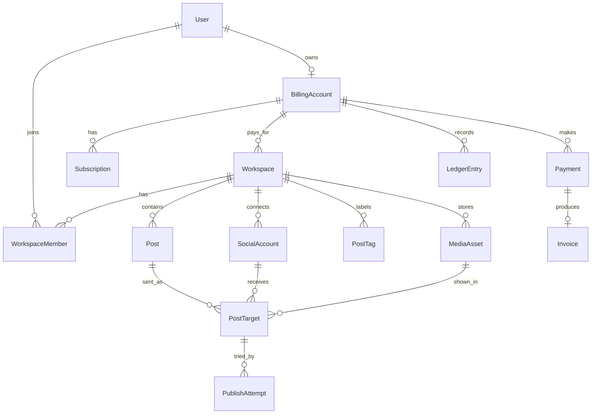

# MySQL schema: proposal for review

Status: **awaiting approval. Nothing has been applied.** Full schema: [schema.proposed.prisma](schema.proposed.prisma) (24 tables, 24 foreign keys). It replaces section 5 of [PLAN.md](PLAN.md) and the PostgreSQL parts of section 7.

Checked: valid in Prisma 6.19; MySQL SQL generates; widest index is about 1,540 bytes (limit 3,072). **Not checked: running it on MySQL.** There is no local MySQL, and I did not use your server for experiments.

## 1. Shape



- One person owns one billing account and any number of workspaces (brands).
- A **Post** is what was written. A **PostTarget** is that post on one platform, with its own status, cost and retries.
- `WorkspaceMember.role` exists now, so v2 teams need no rewrite. v1 creates only OWNER.

## 2. Keeping customers apart

1. Code: `guard()` checks membership, and `dataFor(workspaceId)` adds the workspace to every query.
2. Database: links between posts, media, tags and accounts use the pair `(workspaceId, id)`. MySQL refuses a post that points at another workspace's account or media, even if the code has a bug.
3. An empty link (no media, no account yet) is allowed, because MySQL does not check a pair with an empty part.
4. Rows with a published history cannot be deleted by accident: the links are RESTRICT, so workspaces are archived. Deleting customer data is an ordered job.

## 3. What MySQL changed from the original plan

| Plan (PostgreSQL) | MySQL design | Why |
|---|---|---|
| Find due posts by status, skip locked rows | `claimAt`, filled only while a target may be claimed, with its own index | MySQL locks every row it reads. This way it reads only the rows it takes |
| Lease columns | Claiming moves `claimAt` forward 2 minutes and sets `leaseToken` | A crashed worker's posts reappear by themselves |
| `pollAt` mixed with due time | Separate `pollAt` | Polling and publishing never block each other |
| Partial unique indexes | `claimKey`, `currentKey`: unique, emptied when released | MySQL allows many empty values in a unique column |
| Text arrays | Comma-separated text | No arrays |
| Triggers for append-only tables | Separate database logins (section 6) | Triggers can need rights your login does not have |
| Case-sensitive text | Exact collation on selected columns (section 5) | MySQL treats `é` and `e`, `A` and `a` as equal by default |
| Serializable ledger maths | Lock the billing row, then add up | Same result, fewer deadlocks |

`claimKey` is `platform:platformUserId`. The same Page cannot be active in two workspaces; it becomes empty when the owner removes the account. `Subscription.currentKey` equals the billing account id for the current subscription, so there can only be one. `Post.requestKey` makes a double click create one post.

## 4. Claiming work

```sql
-- one transaction, READ COMMITTED
SELECT id FROM PostTarget FORCE INDEX (PostTarget_claimAt_idx)
 WHERE claimAt <= UTC_TIMESTAMP(3)
 ORDER BY claimAt LIMIT 10 FOR UPDATE SKIP LOCKED;

UPDATE PostTarget
   SET status = 'QUEUED', leaseToken = ?, claimAt = UTC_TIMESTAMP(3) + INTERVAL 2 MINUTE
 WHERE id IN (...);
```

Before anything is sent, a second transaction must still hold the lease, reserve the quota, insert the attempt as SENDING, set PUBLISHING and **empty `claimAt`**. From then on no worker can claim it again. A SENDING attempt older than 5 minutes becomes NEEDS_CHECK and is never resent automatically.

Deadlocks (`P2034`) retry the transaction. No HTTP call happens inside a transaction, so nothing is sent twice by that retry.

Ledger reservation:
```sql
SELECT id FROM BillingAccount WHERE id = ? FOR UPDATE;
SELECT COALESCE(SUM(amount), 0) FROM LedgerEntry
 WHERE billingAccountId = ? AND unit = 'POST' AND periodKey = ?;
-- insert RESERVE -1 only if the sum is at least 1
```
`idempotencyKey` is unique, so a repeat changes nothing.

## 5. Exact-match columns
Added by hand to the migration, since Prisma cannot describe them:
- `utf8mb4_0900_as_cs`: `User.email`, `Account.providerAccountId`, `VerificationToken.*` (already live), `SocialAccount.platformUserId`, `claimKey`, `Subscription.providerRef`, `Payment.providerRef`, `ProviderEvent.eventId`, `PublishAttempt.requestId`, `LedgerEntry.idempotencyKey`, `Notification.dedupeKey`, `Post.requestKey`, `MediaAsset.objectKey`.
- Columns used in foreign keys keep the default collation on both sides.
- CHECK constraints: `gstin` length, `amountMinor >= 0`, `attemptCount >= 0`, currency in capitals.

All times are stored in UTC. A workspace's time zone is applied when showing or choosing a time.

## 6. Database logins

| Login | Rights |
|---|---|
| `socialgem_app` | Read, insert, update, delete on `socialgem`; **no update or delete on `LedgerEntry`, `AuditLog`, `Invoice`**; no table changes |
| `socialgem_migrate` | Table changes on `socialgem` only; used only during a release |
| `socialgem_backup` | Read only |

This needs you, as your database administrator, and replaces the shared login that can reach 13 other databases. MySQL grants cannot subtract a table from a database-wide grant, so the app login gets its rights table by table; I will supply the script.

## 7. Moving from today's tables

| Table | Change |
|---|---|
| `User` | Keeps all accounts. Loses `credits` (the ledger replaces it); gains `isSuperAdmin`, `disabledAt` |
| `Account`, `Session`, `VerificationToken`, `RateLimit` | Kept |
| `ScheduledPost` | **Dropped**, replaced by `Post` and `PostTarget` |
| `PostTag`, `MediaAsset` | **Dropped and created again** for workspaces |
| 17 others | New |

Safety: the release first counts rows in `ScheduledPost`, `PostTag` and `MediaAsset` and **stops if any exist**. They were empty after my last test. MySQL cannot undo a half-finished migration, so a dump is taken first.

Nobody needs data moved: a billing account and first workspace are created for each user from the setup wizard.

## 8. What changes in the app
- Wizard saves to the database; a workspace switcher appears.
- API routes move to `/api/w/{workspaceId}/…`; the current dashboard is adapted to the new shapes.
- Credits shown today disappear until plans exist (M6).
- Every route is added to the two-user test, plus tests that try to cross workspaces at database level.

Effort: about 3 days, including a local or CI MySQL for tests.

## 9. Decisions

1. **Approve the schema?** It is the base for M2 to M7.
2. **Drop the three old tables** if still empty? *Recommended yes.*
3. **Test database:** may I download portable MySQL 8 (about 250 MB zip from dev.mysql.com) for local tests, so your remote server is never used for them? *Recommended yes.* Otherwise tests need a second, empty remote database such as `socialgem_test`.
4. **One target per platform and account** means one post can go to two Facebook Pages. *Recommended yes.*
5. **Quota** counted per target, per calendar period of the subscription? *Recommended yes (plan question 5).*
6. **Several billing owners** for one workspace: not in v1. *Recommended.*
7. **Keep published posts** when a workspace is archived, until the customer asks for deletion? *Recommended yes.*
